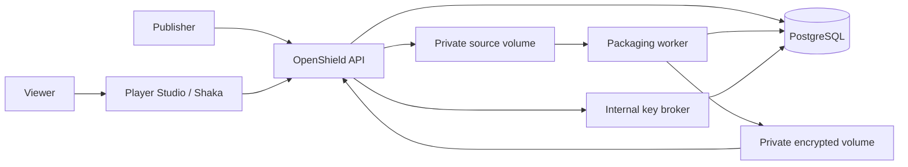

# OpenShield DRM

A self-hosted video protection stack for encrypted packaging and authorized playback. This independent implementation is developed on the `openshield` branch.

## Features

- **Self-hosted ClearKey.** Issue temporary W3C EME licenses on your own server using asset-scoped playback sessions.
- **Encrypted packaging.** Upload H.264 MP4 with optional AAC and produce CBCS-encrypted DASH and HLS with Shaka Packager. Rotation creates a new edition while preserving prior output.
- **Player Studio.** Play protected DASH with the bundled Shaka Player. Customize colors, seeking, keyboard controls, speed, volume, full screen, picture-in-picture where supported, and an optional moving watermark.
- **Privacy curtain.** Pause and black out the player on window blur, tab changes or a manual action. Browser pages have no reliable signal for operating-system screen recording. The watermark is a visible playback overlay.
- **Operator controls.** Provision publishers and viewers, grant content access, inspect job state and revoke sessions. A separately enabled public demo is scoped to a bundled synthetic lesson.

## Architecture



The API checks account, entitlement, session, package version and key status before serving media or issuing a license. The broker unwraps only the content key for the requested package. The master wrapping key stays with the worker and broker.

## Quick Start

### Prerequisites

Linux, Docker Engine and Docker Compose, Git and Python 3. Use HTTPS for browser playback on a remote hostname. Loopback works for local development.

### Installation

```sh
git clone --branch openshield --single-branch https://github.com/islamV/OpenDRM.git openshield-drm
cd openshield-drm
sh infrastructure/setup-media.sh
docker compose up -d --build --wait
```

The setup script generates missing credentials and preserves existing values. The API binds to `127.0.0.1:18321` by default. Change `API_PORT` in `.env` to use a different port.

### Verify Installation

```sh
base=http://127.0.0.1:18321
curl -fsS "$base/health"
curl -fsS "$base/api/v1/license/capabilities"
```

A running Compose deployment advertises `{"clearkey":true,"widevine":false,"fairplay":false}`. A capabilities response with all flags false indicates the API has no broker configuration. If the path returns 404, verify that the request reaches the `openshield` branch build and compare the loopback and reverse proxy responses.

## Usage

### 1. Play the Sample

```sh
docker compose run --rm --no-deps -T migrate node dist/studio-demo.js
```

Open [Player Studio](http://127.0.0.1:18321/player/) and select the protected sample. This operator command enables public playback for the bundled lesson using a dedicated viewer entitlement. Studio also includes a clear local preview for testing layout and controls.

### 2. Package Content

Run the following from a private server shell with `jq` installed and an MP4 file named `lesson.mp4`, up to 128 MiB.

```sh
base=http://127.0.0.1:18321
publisher=$(docker compose run --rm --no-deps -T migrate node dist/provision.js publisher | jq -er .credential)
token=$(curl -fsS -X POST -H "Authorization: Bearer $publisher" "$base/api/v1/auth/token" | jq -er .token)
auth="Authorization: Bearer $token"
content=$(curl -fsS -H "$auth" -H 'Content-Type: application/json' \
  -d '{"title":"Training film"}' "$base/api/v1/content" | jq -er .id)
upload=$(curl -fsS -H "$auth" -H 'Content-Type: video/mp4' \
  --data-binary @lesson.mp4 "$base/api/v1/content/$content/assets")
job=$(printf '%s' "$upload" | jq -er .jobId)
asset=$(printf '%s' "$upload" | jq -er .assetId)
curl -fsS -H "$auth" "$base/api/v1/jobs/$job" | jq .
```

A 202 response acknowledges the submission. Poll the job until it reaches `completed` or `failed`. The job returns private storage paths for both output formats. To create a new edition, send an authenticated POST to `/api/v1/assets/$asset/rotate`.

### 3. Authorize a Viewer

The owner can play a completed job. Other accounts need a content entitlement, managed by the operator in `content_entitlements`. Provision a `viewer` identity for playback users. Authenticate with the provisioned credential on your backend and obtain a user session using `POST /api/v1/auth/token`.

### 4. Play Content in a Browser

For operator testing, enter the job identifier and authorized user session in [Player Studio](http://127.0.0.1:18321/player/). For an application integration, exchange the user session with `POST /api/v1/jobs/:id/playback`. Use the returned `manifestUrl` and `licenseUrl` in Shaka Player and attach the returned playback bearer only to the same-origin request URLs scoped to its session. Playback sessions last at most five minutes and end sooner if the parent session expires. [Shaka Player license authentication](https://shaka-project.github.io/shaka-player/docs/api/tutorial-license-server-auth.html)

## API Reference

| Method | Endpoint | Access or action |
|---|---|---|
| GET | `/health` | API and database readiness |
| GET | `/api/v1/license/capabilities` | Public discovery |
| POST | `/api/v1/auth/token` | Provisioned credential to user session |
| POST | `/api/v1/auth/validate` | Inspect the authenticated identity |
| DELETE | `/api/v1/auth/session` | Revoke the user session |
| POST | `/api/v1/content` | Publisher creates content |
| GET | `/api/v1/content/:id` | Owner or entitled viewer reads metadata |
| POST | `/api/v1/content/:id/assets` | Owner uploads raw MP4 |
| GET | `/api/v1/jobs/:id` | Owner inspects packaging status |
| POST | `/api/v1/assets/:id/rotate` | Owner submits key rotation |
| POST | `/api/v1/jobs/:id/playback` | Authorized viewer starts playback |
| GET, HEAD | `/api/v1/playback/:id/media/:filename` | Session-bound media with byte ranges |
| POST | `/api/v1/playback/:id/license` | Temporary ClearKey license for the session KID |
| DELETE | `/api/v1/playback/:id` | Revoke the playback session |

## DRM Support

| System | Status |
|---|---|
| **ClearKey** | Self-hosted licenses and DASH browser playback. ClearKey returns the content key to an authorized client. |
| **Widevine** | Planned. Google offers a License Server SDK for licensed partners that want to operate their own service. [Google Widevine overview](https://developers.google.com/widevine/drm/overview) |
| **FairPlay Streaming** | Planned. Apple provides a Server SDK for your own Key Server Module and requires approval for deployment credentials. [Apple FairPlay Streaming](https://developer.apple.com/streaming/fps/) |

Shaka Packager also creates encrypted HLS. The bundled browser player uses DASH for its ClearKey playback path.

## Development

Use Node.js 22.12+ and PostgreSQL 16. Set `TEST_DATABASE_URL` to a disposable PostgreSQL database with schema-owner permissions.

```sh
npm ci --ignore-scripts
npm test
npm audit
python3 tests/media-smoke.py
```

The smoke test requires a running Compose stack. Run `python3 tests/playback-smoke.py` with Playwright and a Chromium build that supports H.264, AAC and ClearKey CBCS. Set `PLAYWRIGHT_MODULE` and `CHROMIUM_PATH` for external installations.

## Project Structure

```text
services/core/src/     HTTP API, playback, broker, and packaging worker
database/migrations/   PostgreSQL schemas and permissions
infrastructure/       Environment setup and database bootstrap
docs/                 Player Studio, samples and operator documentation
tests/                Unit, HTTP, packaging and browser tests
docker-compose.yml    Local service orchestration
```

## Security Considerations

Keys at rest use AES-GCM envelope encryption. Auth and playback tokens are stored as digests. The broker and media volumes are private. Keep the original `.env`, including `MEDIA_KEK`, alongside backups of all three named volumes. Set appropriate HTTPS access controls before exposing an API behind a reverse proxy.

## License

[MIT](LICENSE)

## Contributing

See the [contributing guide](CONTRIBUTING.md) for verification and migration conventions.

## Support and Documentation

- [Interactive server guide in Arabic](docs/server-guide-ar.html)
- [Player Studio and frontend guide in Arabic](docs/frontend-player-ar.html)
- [Architecture](ARCHITECTURE.md) and [implementation milestones](IMPLEMENTATION_PLAN.md)
- [Verification record](docs/VERIFICATION.md) and [security review](SECURITY_AUDIT.md)
